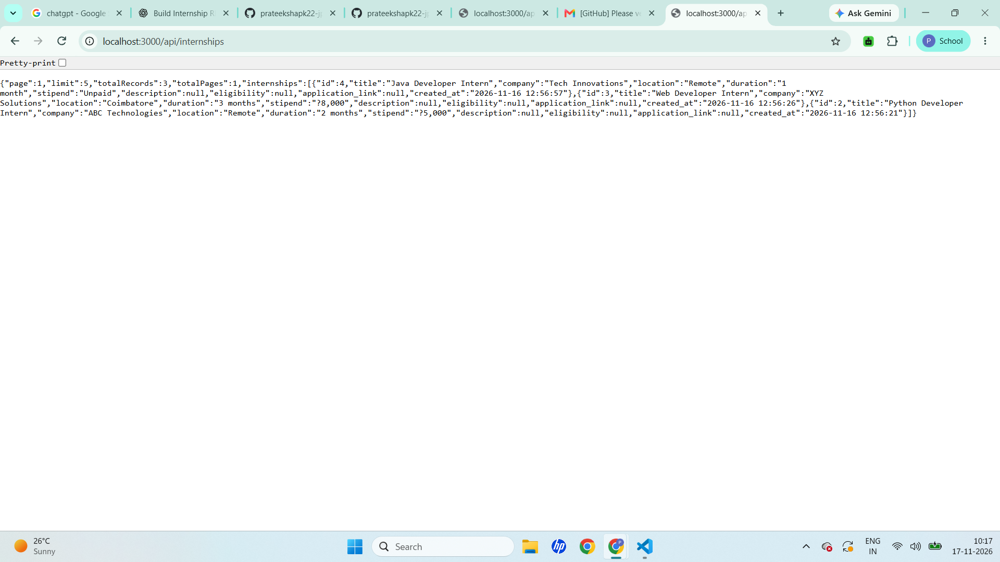
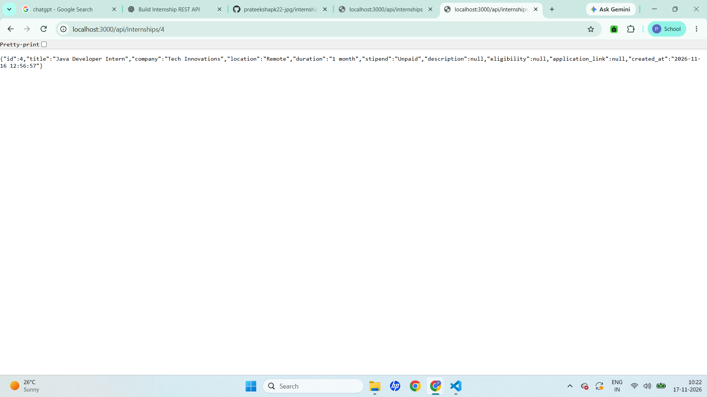
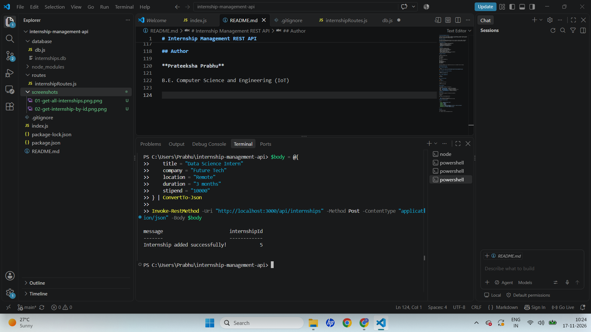
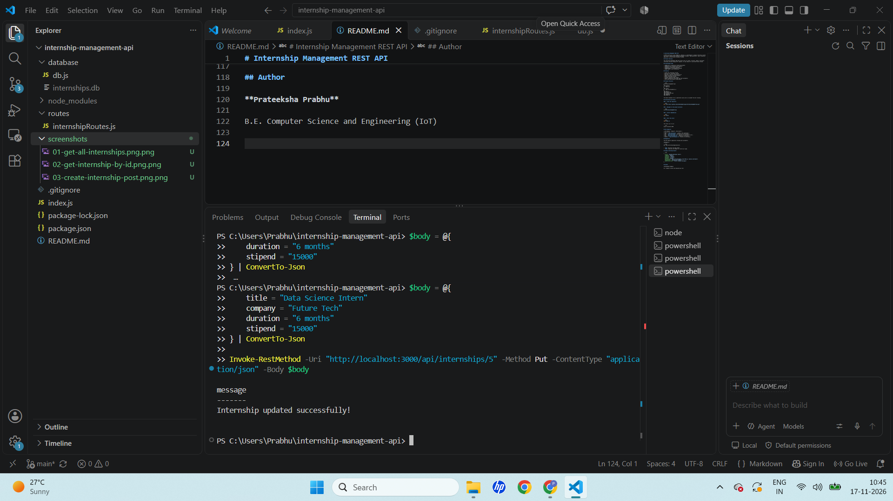
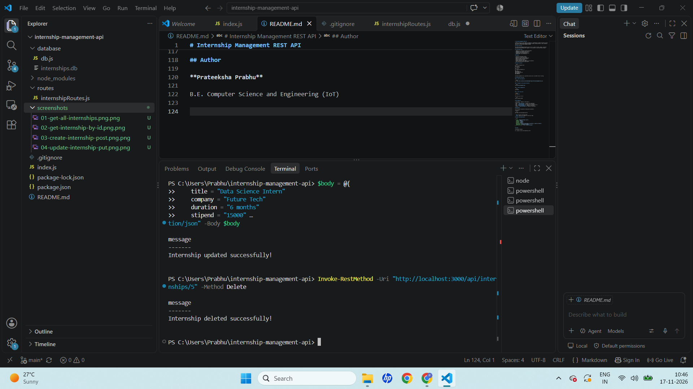

# Internship Management Portal & REST API

A full-stack Internship Management Portal developed using **Node.js, Express.js, SQLite, HTML, CSS, and JavaScript**. The application allows users to manage internship records through a web interface and RESTful API.

## Project Overview

The Internship Management Portal provides functionality to create, view, search, update, and delete internship records. It integrates a frontend interface with a Node.js backend and SQLite database.

The project demonstrates full-stack development, CRUD operations, database integration, input validation, pagination, and API security.

## Technologies Used

- **Node.js** – JavaScript runtime environment
- **Express.js** – Backend web framework
- **SQLite** – Relational database
- **JavaScript** – Application functionality
- **HTML5** – Frontend structure
- **CSS3** – Frontend styling
- **Zod** – Input validation
- **Helmet** – HTTP security headers
- **CORS** – Cross-Origin Resource Sharing
- **Express Rate Limit** – API request limiting

## Features

### Frontend Features
- Dashboard for managing internships
- Add new internship records
- View internship details
- Edit existing internship records
- Delete internship records
- Search internship records
- Form validation

### Backend Features
- RESTful API implementation
- Create, Read, Update, and Delete (CRUD) operations
- SQLite database integration
- Input validation
- Pagination support
- Centralized error handling

### Security Features
- Helmet security headers
- CORS origin restrictions
- API rate limiting
- JSON request body size restriction
- Zod-based input validation
- Parameterized SQL queries

## Project Structure

```text
internship-management-api/
│
├── database/
│   └── db.js
│
├── public/
│   ├── app.js
│   ├── index.html
│   └── style.css
│
├── routes/
│   └── internshipRoutes.js
│
├── screenshots/
│   ├── 01-get-all-internships.png
│   ├── 02-get-internship-by-id.png
│   ├── 03-create-internship-post.png
│   ├── 04-update-internship-put.png
│   └── 05-delete-internship.png
│
├── index.js
├── package.json
├── package-lock.json
├── .gitignore
└── README.md
```

## Installation and Setup

### 1. Clone the Repository

```bash
git clone https://github.com/prateekshapk22-jpg/internship-management-api.git
```

### 2. Navigate to the Project Directory

```bash
cd internship-management-api
```

### 3. Install Dependencies

```bash
npm install
```

### 4. Start the Application

```bash
npm start
```

For development:

```bash
npm run dev
```

The application runs at:

```text
http://localhost:3000
```

## API Endpoints

## API Testing Screenshots










## Pagination
## API Usage Examples

### 1. Create an Internship (POST)

**Request:**

```http
POST /api/internships
Content-Type: application/json
```

**Request Body:**

```json
{
  "title": "Data Science Intern",
  "company": "Future Tech",
  "location": "Remote",
  "duration": "6 months",
  "stipend": "15000"
}
```

**Successful Response:**

```json
{
  "message": "Internship added successfully!",
  "internshipId": 5
}
```

### 2. Get All Internships (GET)

**Request:**

```http
GET /api/internships
```

**Response:**

Returns a list of internship records along with pagination details, including page number, limit, total records, and total pages.

### 3. Get Internship by ID (GET)

**Request:**

```http
GET /api/internships/4
```

**Response:**

Returns the internship record matching the specified ID.

### 4. Update an Internship (PUT)

**Request:**

```http
PUT /api/internships/5
Content-Type: application/json
```

**Successful Response:**

```json
{
  "message": "Internship updated successfully!"
}
```

### 5. Delete an Internship (DELETE)

**Request:**

```http
DELETE /api/internships/5
```

**Successful Response:**

```json
{
  "message": "Internship deleted successfully!"
}
```
The API supports pagination using query parameters.

Example:

```http
GET /api/internships?page=1&limit=2
```

- `page` specifies the page number.
- `limit` specifies the number of records per page.

## Sample Internship Record

```json
{
  "title": "Backend Developer Intern",
  "company": "Edvyro",
  "location": "Remote",
  "duration": "1 month",
  "stipend": "Unpaid",
  "description": "REST API development using Node.js, Express and SQLite",
  "eligibility": "Engineering students",
  "application_link": "https://example.com/apply"
}
```

## Security Testing

The following security tests were performed:

| Security Test | Expected Result | Status |
|---|---|---|
| Helmet headers | Security headers present | Passed |
| Unauthorized CORS origin | HTTP 403 | Passed |
| Oversized JSON request | HTTP 413 | Passed |
| Rate limiting | HTTP 429 | Passed |
| Invalid input validation | HTTP 400 | Passed |

## Database

The application uses SQLite for persistent data storage. The database is generated locally by the application and excluded from Git tracking.

## Author

**Prateeksha Prabhu**

B.E. Computer Science and Engineering (IoT)

Sri Krishna College of Engineering and Technology
